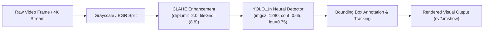

# 🚗 TrafficVision — Real-Time Highway Object Detection & Tracking

[](https://www.python.org/)
[](https://github.com/ultralytics/ultralytics)
[](https://opencv.org/)

A real-time computer vision pipeline engineered for multi-class vehicular detection, highway traffic flow tracking, and dynamic lighting contrast enhancement using **YOLO11** and **CLAHE** (Contrast Limited Adaptive Histogram Equalization).

---

## 🎯 Project Overview

Accurate traffic monitoring on high-speed transit corridors is frequently impaired by harsh lighting variances, headlights, shadows, and weather atmospheric distortion. 

**TrafficVision** integrates:
- **Contrast Enhancement**: CLAHE transforms grayscale luminance tiles ($8 \times 8$ grid, clip limit $2.0$) to prevent shadow loss without amplifying high-frequency noise.
- **YOLO11 Nano Inference**: Utilizes Ultralytics YOLO11 (`yolo11n.pt`) tuned for ultra-low latency inference, high frame rates ($>60$ FPS on modern GPUs), and reliable multi-scale vehicle localization (cars, trucks, buses, motorcycles).
- **High-Resolution Evaluation**: Evaluated across 4K transit corridor video footage with multi-object IoU non-maximum suppression ($0.75$) and confidence thresholding ($0.65$).

---

## 🔬 Computer Vision Pipeline



---

## 📁 Repository Structure

```
├── yolo11n.pt           # Pre-trained YOLO11 Nano weights
├── vidtrial.py          # Real-time video detection and bounding box visualization
├── clahetrial.py        # Video inference coupled with CLAHE contrast preprocessing
├── imagetrial.py        # Static image detection test harness
├── classes.py           # Object class definitions and taxonomy
└── README.md
```

---

## 🚀 Setup & Execution

### Prerequisites
- Python 3.9+
- Webcam or video file

### 1. Installation
```bash
git clone https://github.com/karnam-ui/traffic-vision-yolo.git
cd traffic-vision-yolo
pip install ultralytics opencv-python
```

### 2. Run Video Inference
```bash
# Standard detection
python vidtrial.py

# Contrast-enhanced CLAHE detection
python clahetrial.py
```

Press `q` at any time to exit the video display stream.

---

## 📄 License
This project is open-source under the [MIT License](LICENSE).
